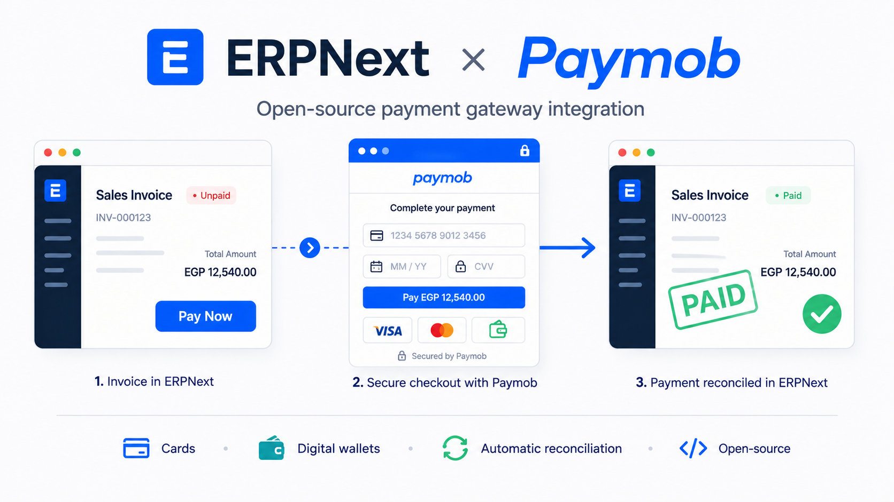

<p align="center">
  
</p>

<h1 align="center">Paymob Integration for ERPNext</h1>

<p align="center">
  <strong>Let your customers pay their ERPNext invoices online with a card or a mobile wallet.<br>
  When they pay, the invoice is marked paid for you.</strong>
</p>

<p align="center">
  
  
  
</p>

<p align="center">
  <a href="https://www.youtube.com/watch?v=2WK-7etKyto">
    
  </a>
</p>

<p align="center">
  <em>See the app explained and working end to end. Spoken in Arabic.</em>
</p>

---

## The problem this solves

You send an invoice from ERPNext. Your customer pays it somehow — a transfer, a link you sent by
hand, a card machine in the shop. Then someone on your team opens ERPNext and marks the invoice as
paid.

That last step is the problem. It is manual, it happens hours or days late, and people make
mistakes. Your books and your bank account disagree until someone fixes them.

This app removes that step. Your customer pays through Paymob, and ERPNext records the payment by
itself.

## How it works

**1. Send the invoice.** ERPNext creates a payment link for the invoice.

**2. The customer pays.** The link opens Paymob's secure payment page. They pay with a card or a
mobile wallet. They never leave Paymob's page to enter their card, so their card number never
touches your server.

**3. ERPNext records it.** Paymob tells the app the payment succeeded. The app checks the message
is genuine, then creates the Payment Entry and marks the invoice paid. Nobody has to type anything.

## What you need

- Frappe and ERPNext version 16
- Python 3.14
- A Paymob merchant account (start with a test account)
- A site reachable from the internet over HTTPS, so Paymob can send it messages

## Install

```bash
bench get-app https://github.com/NotAbdelrahmanelsayed/paymob_integration --branch version-16
bench --site <your-site> install-app paymob_integration
bench --site <your-site> migrate
```

## Set up

1. Open **Paymob Settings** in ERPNext.
2. Enter your Secret Key, API Key, and HMAC Secret from your Paymob dashboard. These are stored as
   passwords, not plain text.
3. Enter your public key, then add a row for each country and currency you sell in, with the
   matching Integration ID from Paymob. The country, currency, and mode must match on every row.
4. Leave the mode on **Test** and use your Paymob test credentials first. Never put live keys into a
   test site.
5. Check that your site knows its own public address. The app tells Paymob where to send the
   result of each payment, and it builds that address from your site's URL. If the URL is wrong or
   missing, Paymob has nowhere to reply and your payments will sit unconfirmed. You can check it
   with:

   ```bash
   bench --site <your-site> execute frappe.utils.get_url
   ```

   The address is the last line of the output. It must be the real, public HTTPS address of your
   site — not `localhost`, and not an internal address. If it is wrong, set `host_name` in your
   site config.

The [user guide](docs/user-guide/README.md) walks through the whole setup with more detail.

## Before you accept real money

A successful test payment does not prove you are ready for live payments. Please:

- Switch to live credentials, and change any password or key you used while testing.
- Make sure your site is on HTTPS and stays online — backups, the scheduler, and background workers
  all running.
- Run through the [smoke-test checklist](docs/developer-guide/sandbox-smoke-test.md).
- Do one small real payment and check the invoice, the Payment Entry, and your Paymob dashboard all
  agree.

## Documentation

- [User guide](docs/user-guide/README.md) — setup and daily use
- [Developer guide](docs/developer-guide/README.md) — how it is built and how to extend it
- [Why it is built this way](docs/reference/decisions.md) — the reasoning behind each design choice
- [Security policy](SECURITY.md)
- [Contributing](CONTRIBUTING.md)
- [Changelog](CHANGELOG.md)

## Roadmap

**Work with the ERPNext `payments` app.** Right now this app handles Payment Requests. If it also
registered itself as a standard ERPNext payment gateway, the webshop "Pay Now" button and the point
of sale screen would work with Paymob without any extra setup. This needs a design decision first:
the standard interface expects one gateway account per site, while this app supports several
countries and currencies at once.

## Upgrading

Take a backup you have actually tested restoring. Try the upgrade on a copy of your site first. Read
the [changelog](CHANGELOG.md) before you update.

## Contributing

Bug reports and pull requests are welcome. See [CONTRIBUTING.md](CONTRIBUTING.md) for how to set up
your environment and what a change needs before it can be merged.

## License

MIT. See [license.txt](license.txt).
